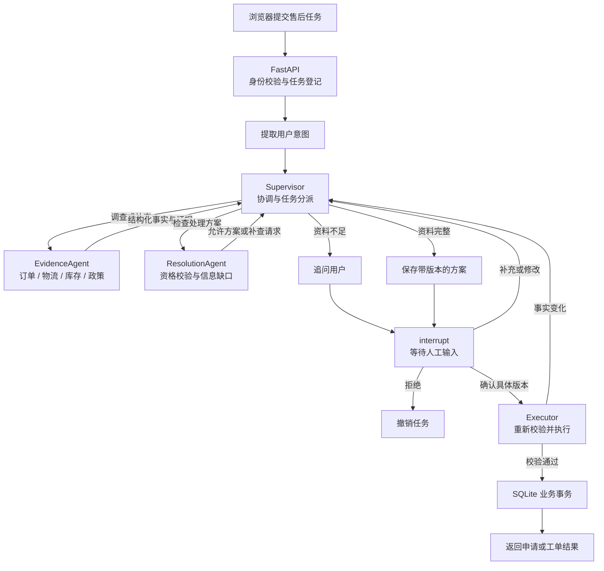

# AfterSale-Agent

> 面向电商售后场景的多 Agent 任务系统，支持证据调查、资格判断、异常补查、人工确认与持久化恢复。

AfterSale-Agent 使用 **LangGraph StateGraph** 编排售后处理流程，通过 **Supervisor、EvidenceAgent、ResolutionAgent** 三个固定角色，将用户请求转化为有政策依据、经过确认、可以追踪的业务操作。

项目延续 [ShopSupport-RAG](https://github.com/OYHR2048/ShopSupport-RAG) 的电商业务场景，选择性复用中文检索模块与政策文档，进一步实现 **多步骤任务执行、角色上下文隔离、方案版本管理、事务提交与重启恢复**。

用户可以在浏览器中提出售后请求，查看工具调用和政策证据，补充信息或修改方案，并在确认后提交申请。

**默认演示使用规则决策替身，无需模型密钥。订单、库存和售后业务均为本地模拟数据；申请受理不代表审核通过或退款到账。**

---

## ✨ 核心能力

- **多 Agent 编排**：协调者分派调查与方案任务，根据资料缺口组织追问、补查和重新规划。
- **有界工具循环**：专业角色执行“决策 → 工具 → 观察 → 再决策”，配置步数、委派次数、超时和重试边界。
- **上下文隔离**：各专业角色使用独立的任务上下文，通过结构化事实和证据交接结果。
- **政策检索**：中文 BM25 与标题词面排名通过 RRF 融合，返回政策原文、来源、版本和内容指纹。
- **资格校验**：结合订单状态、签收时间、商品类型、用户声明和库存，计算允许动作及待补充信息。
- **异常处理**：覆盖定制商品质量问题、换货缺库存、已发货无法取消、物流停滞和业务状态冲突。
- **方案确认**：确认绑定具体 `proposal_id` 与版本；修改、过期或事实变化后，旧确认失效。
- **受控业务执行**：执行前重新检查身份、订单、库存、政策和资格，使用事务与唯一约束防止重复写入。
- **持久化恢复**：保存图执行状态，支持等待确认期间重启，以及业务提交后退出的恢复对账。
- **浏览器任务台**：展示对话、已保存任务、处理方案、政策证据、执行结果和 SSE 事件时间线。
- **单 Agent 对照**：单、多 Agent 共用工具、数据、权限与执行器，支持相同任务条件下的比较。
- **任务评测**：检查最终任务状态、业务动作、确认记录、证据、重复写入及恢复结果。

---

## 🏗️ 系统架构

### 多 Agent 工作流



三个角色的职责和工具权限分别限定：

| 角色 | 职责 | 可用能力 |
|---|---|---|
| `Supervisor` | 判断下一步、分派任务、追问、汇总与停止 | 选择调查、方案、追问或提案路径 |
| `EvidenceAgent` | 收集订单事实与政策证据 | 订单、明细、物流、库存和政策检索 |
| `ResolutionAgent` | 检查售后资格，返回允许方案或资料缺口 | `check_eligibility` |
| `Executor` | 确认后的业务校验与事务写入 | 普通后端执行模块，不属于 Agent |

专业角色完成任务后返回协调者。缺少库存或政策时，可以再次派发调查；缺少用户声明时，暂停等待补充。

当前采用 **固定角色、顺序委派、结构化上下文交接**。金额、身份和业务硬约束由程序校验，业务写入集中在执行器中。

### 政策证据与业务事实

```text
用户请求
   │
   ├── 订单 / 明细 / 物流 / 库存工具
   │          ↓
   │      结构化业务事实
   │
   └── 政策检索工具
              ↓
       BM25 + 标题词面排名
              ↓
           RRF 融合
              ↓
       原文 + 来源 + 版本
              │
              ↓
        售后资格与方案校验
              ↓
        保存方案并等待确认
```

政策负责提供处理依据，业务工具负责提供具体订单事实。检索片段包含 `document_id`、`chunk_id`、`policy_version` 与内容指纹，便于追踪方案依据并检测政策变化。

详细数据流见 [`docs/ARCHITECTURE.md`](docs/ARCHITECTURE.md)。

---

## 📊 Benchmark

评测集包含 **40 条人工预期任务**，划分为 **10 条开发集、30 条测试集**，覆盖正常售后、多轮补充、异常分支、权限、重复确认和恢复场景。

下面是仓库保存的 **2026-10-12 离线测试结果**：

| 指标 | Single Agent | Multi Agent |
|---|---:|---:|
| 满足任务预期，含正确拒绝或等待 | 30/30 | 30/30 |
| 安全失败 | 0 | 0 |
| 重复业务记录 | 0 | 0 |
| 恢复样例符合预期 | 2/2 | 2/2 |
| 引用结构校验通过 | 30/30 | 30/30 |
| 中位总耗时 | 384.10 ms | 459.60 ms |
| 决策调用次数 | 208 | 405 |
| 真实模型 HTTP 调用次数 | 0 | 0 |

主要结论：

- 两种模式在当前离线任务集上的结果相同。
- 多 Agent 展示了职责隔离、结构化交接与异常补查，同时增加了决策和运行开销。
- 未确认、越权、重复确认及状态变化等行为，通过业务数据库断言检查。
- 当前没有观察到多 Agent 的任务完成率增益。

**上述决策使用规则替身，不代表真实模型质量。** 引用指标检查文本、版本、ID 与必要政策覆盖，不等于语义回答正确率；耗时来自一次本地运行，不是统计显著性实验。

评测口径、逐例结果和验证范围：

- [评测说明](https://github.com/OYHR2048/AfterSale-Agent/blob/main/docs/EVALUATION.md)
- [`reports/test_demo.json`](reports/test_demo.json)
- [`reports/validation.json`](reports/validation.json)

---

## 🚀 快速开始

### 安装

建议使用 **Python 3.12**。项目版本约束为 `>=3.12,<3.14`，已有验证环境为 Windows + Python 3.12。

以下命令使用 Windows PowerShell：

```powershell
git clone https://github.com/OYHR2048/AfterSale-Agent.git
cd AfterSale-Agent

python -m venv ..\aftersale-runtime\.venv

$projectPython = (Resolve-Path ..\aftersale-runtime\.venv\Scripts\python.exe).Path
$env:PYTHONDONTWRITEBYTECODE = '1'

& $projectPython -m pip install -r requirements.lock
```

虚拟环境和运行数据放在仓库外，保持源码目录与业务数据分离。

### 启动服务

在项目根目录配置并启动：

```powershell
$env:AFTERSALE_RUNTIME_DIR = '..\aftersale-runtime\data'
$env:AFTERSALE_MODE = 'demo'
$env:AFTERSALE_ALLOW_MODEL = 'false'

& $projectPython -m uvicorn aftersale.api:app --host 127.0.0.1 --port 8018
```

默认使用 SQLite、虚构政策和规则决策，不需要启动额外数据库服务或下载模型权重。

- 任务界面：[http://127.0.0.1:8018](http://127.0.0.1:8018)
- API 文档：[http://127.0.0.1:8018/docs](http://127.0.0.1:8018/docs)
- 运行状态：[http://127.0.0.1:8018/health](http://127.0.0.1:8018/health)

本项目读取进程环境变量，**不会自动加载 `.env` 文件**。配置字段见 [`.env.example`](.env.example)。

### 登录任务台

首次启动会在运行目录生成 `auth.json`。

另开一个 PowerShell 终端，进入项目根目录，读取 `alice` 的开发凭据：

```powershell
$demoAuth = Get-Content ..\aftersale-runtime\data\auth.json -Raw | ConvertFrom-Json
$demoAuth.alice
```

将输出粘贴到页面的“开发身份”输入框中登录。

- `alice`：拥有 `ORD10001`–`ORD10008` 和 `ORD10010`。
- `bob`：拥有 `ORD10009`，用于身份隔离测试。
- `admin`：用于演示环境的故障与状态变化注入。

凭据由服务端映射到身份；这是一套本地开发机制。

### 开始任务

| 场景 | 示例输入 | 预期流程 |
|---|---|---|
| 正常退货 | `ORD10001 无理由退货，未拆封且完好` | 检查订单和政策，形成待确认方案 |
| 定制质量问题 | `ORD10002 定制杯质量问题，照片显示破损，超过七天，优先换货` | 初次调查、资格校验、库存补查、等待确认 |
| 缺少凭证声明 | `ORD10002 质量问题` | 追问；可补充 `照片显示杯身破损` |
| 换货缺库存 | `ORD10004 质量问题，照片显示错字，想换货` | 给出退货退款等可行方案 |
| 未发货取消 | `ORD10003 取消订单` | 校验状态，确认后取消 |
| 已发货取消 | `ORD10005 取消订单` | 转人工咨询拦截或后续处理 |
| 物流异常 | `ORD10006 物流停滞，请转人工工单` | 确认后创建本地模拟工单 |

页面可以选择 **三个角色协作** 或 **单 Agent 对照**。

用户声明“有照片”仅作为任务信息，本期没有图片上传与视觉审核。所有写入操作都需要确认当前方案。

### 恢复与重新演示

使用同一运行目录重启服务，登录后选择已保存任务，点击“恢复此任务”，可以继续等待或执行流程。

如果需要重新演示已处理订单，停止服务后改用新的数据目录：

```powershell
$env:AFTERSALE_RUNTIME_DIR = '..\aftersale-runtime\data-new'

& $projectPython -m uvicorn aftersale.api:app --host 127.0.0.1 --port 8018
```

新目录初始化新的演示数据，原数据库保留。新运行目录也会生成新的开发凭据。

---

## 🔧 业务工具与操作确认

### 只读工具

| Tool | 功能 |
|---|---|
| `get_order` | 查询当前身份的订单金额、日期与状态 |
| `get_items` | 查询 SKU、定制标志和商品数量 |
| `get_logistics` | 查询物流观察及状态 |
| `get_inventory` | 查询库存快照，不预留库存 |
| `search_policy` | 返回政策原文、来源和版本 |
| `check_eligibility` | 返回允许动作、用户资料缺口和工具补查需求 |

工具调用依次检查角色白名单、参数 schema、任务目标与身份归属。模型不能通过修改参数切换订单或伪造资格信息。

### 确认与执行

```text
生成允许的售后方案
        ↓
保存方案 ID / 版本 / 参数 / 事实 / 引用 / 有效期
        ↓
用户确认具体版本
        ↓
重新检查身份、订单、库存、政策和资格
        │
        ├── 事实变化 → 旧方案失效 → 重新规划与确认
        │
        └── 校验通过
                ↓
       原子提交确认、库存及业务记录
                ↓
       保存执行结果并返回申请单号
```

执行器支持四类动作：

- `return_refund`：创建退货退款申请。
- `exchange`：创建换货申请，并在事务中预留库存。
- `cancel`：取消符合条件的未发货订单。
- `manual_ticket`：创建人工处理工单。

方案默认有效期为 **15 分钟**。用户修改方案后生成新版本，旧确认不能执行。

确认、库存预留、申请记录和方案结果在同一业务事务中提交。重复确认返回已保存结果；若进程在业务提交后、图 checkpoint 保存前退出，恢复时根据已提交记录对账。

详细说明见 [`docs/SECURITY.md`](docs/SECURITY.md) 和 [`docs/ARCHITECTURE.md`](docs/ARCHITECTURE.md)。

---

## 🧠 模型配置与 RAG 接入

### 运行模式

| 模式 | 决策后端 | 用途 |
|---|---|---|
| `demo` | `DemoProvider` 规则替身 | 无密钥演示业务闭环 |
| `test` | `ScriptedProvider` 测试注入 | 验证异常与权限边界 |
| `model` | `ModelProvider` JSON 模型适配器 | 真实模型决策入口 |

模型适配器接收结构化 JSON，再由程序校验和分派工具。当前采用 JSON 决策协议，未使用原生 `tools/tool_calls` 消息协议。

### 真实模型

在启动服务的 PowerShell 终端中设置：

```powershell
$env:AFTERSALE_MODE = 'model'
$env:AFTERSALE_ALLOW_MODEL = 'true'

$env:AFTERSALE_MODEL_API_KEY = 'your-api-key'
$env:AFTERSALE_MODEL_BASE_URL = 'https://api.deepseek.com/v1'
$env:AFTERSALE_MODEL = 'deepseek-chat'
$env:AFTERSALE_MODEL_CALL_LIMIT = '40'
```

随后重新启动服务。

真实模型请求使用任务级调用上限和超时控制。API 调用可能产生费用，调用次数上限不等于金额预算。

**当前仓库已验证模型协议、输出校验和失败计数的模拟测试；真实模型质量尚未完成评测。**

### 复用原 RAG

独立演示选择性复用了 ShopSupport-RAG 的分词、BM25、RRF 和政策文档，无需同时启动原项目。

也可以通过 `AFTERSALE_RAG_URL` 配置只读检索接口。接口接收：

```json
{
  "query": "定制商品质量问题如何处理",
  "top_k": 6
}
```

返回片段需要包含 `document_id`、`policy_version` 和 `content`，并与本地受信任政策匹配。

该入口是 HTTP 检索适配器，原 RAG 服务的端到端桥接尚未验证。协议和适配要求见 [`docs/RAG_ADAPTER.md`](docs/RAG_ADAPTER.md)。

---

## 📁 项目结构

```text
AfterSale-Agent/
├── aftersale/
│   ├── api.py           # FastAPI、开发身份与 SSE
│   ├── config.py        # 运行模式、预算与数据目录
│   ├── graph.py         # LangGraph 编排与专业角色循环
│   ├── providers.py     # 规则、测试与 JSON 模型适配
│   ├── models.py        # 意图、工具参数、方案与响应模型
│   ├── tools.py         # 工具注册、白名单、超时与重试
│   ├── policy.py        # 政策检索、引用及版本校验
│   ├── eligibility.py   # 确定性售后资格规则
│   ├── executor.py      # 确认校验与业务事务
│   ├── persistence.py   # SQLite checkpoint
│   ├── service.py       # 依赖组装、任务运行与恢复
│   ├── db.py            # 业务数据、方案与事件持久化
│   ├── retrieval/       # 分词、BM25 与 RRF
│   ├── knowledge/       # 六份虚构政策文档
│   ├── data/            # 演示订单与库存种子
│   └── static/          # 浏览器任务台
├── evaluation/          # 人工预期任务与单、多 Agent 评测
├── tests/               # 工作流、API、模型和检索适配测试
├── reports/             # 已保存评测结果与验证记录
├── scripts/             # 启动、公开文件检查及验证辅助
├── docs/                # 架构、安全、评测与来源说明
├── LICENSES/            # 复用源码的上游许可证
├── .env.example
├── requirements.lock
├── pyproject.toml
├── LICENSE
└── README.md
```

运行数据保存在仓库外：

```text
aftersale-runtime/
├── .venv/
└── data/
    ├── auth.json         # 开发凭据
    ├── business.db       # 订单、任务、方案、申请与事件
    └── checkpoints.db    # LangGraph 执行状态
```

建议阅读顺序：

1. [项目范围与成功标准](docs/SPEC.md)
2. [架构与控制流](docs/ARCHITECTURE.md)
3. `graph.py` → `tools.py` → `eligibility.py`
4. `executor.py` → `service.py` → 对应测试
5. [评测结果与口径](docs/EVALUATION.md)
6. [实际失败与修复](docs/FAILURES.md)

---

## 🧪 测试与评测

以下命令在项目根目录运行，并沿用安装时设置的 `$projectPython`。

### 自动化测试

```powershell
& $projectPython -m pytest -q --basetemp ..\aftersale-runtime\tests-run
```

仓库保存的完整测试记录：

```text
47 passed
```

覆盖业务分支、未确认与越权拦截、重复确认、旧版本失效、事实变化、超时重试、上下文隔离、API/SSE，以及真实子进程退出后的恢复。

### 代码检查

```powershell
& $projectPython -m ruff check --no-cache aftersale evaluation tests scripts

& $projectPython -m ruff format --check --no-cache aftersale evaluation tests scripts
```

### 离线对照评测

```powershell
& $projectPython -m evaluation.run `
  --mode demo `
  --split dev `
  --runtime-dir ..\aftersale-runtime\eval-dev `
  --output ..\aftersale-runtime\dev.json

& $projectPython -m evaluation.run `
  --mode demo `
  --split test `
  --runtime-dir ..\aftersale-runtime\eval-test `
  --output ..\aftersale-runtime\test.json
```

每条任务分别运行 single/multi。每次评测使用新的运行目录，避免历史业务记录污染结果。

真实模型小规模评测入口：

```powershell
& $projectPython -m evaluation.run `
  --mode model `
  --allow-model `
  --model-call-budget 30 `
  --limit 1 `
  --split dev `
  --runtime-dir ..\aftersale-runtime\model-one `
  --output ..\aftersale-runtime\model-one.json
```

该命令需要先配置模型环境变量，会调用真实 API。`--limit 1` 选取一条任务，分别评测单、多 Agent；调用预算覆盖两种模式的请求。

---

## ⚠️ 已知限制

- 默认决策为规则替身，仅支持已设计的演示输入；真实模型泛化与协作收益尚未验证。
- 本地 RAG 使用六份短政策的词面检索，未接入原项目的完整向量检索和重排链路。
- 资格规则与政策由开发者同步维护，不能自动解释任意新增政策。
- 每单一个 SKU、一件商品，最多一笔业务记录；不支持部分退款和复杂多次售后。
- 用户凭证仅作为声明，未实现图片审核。
- 当前使用单进程任务锁与开发身份机制，未验证多 worker、大规模并发或生产认证。
- SSE 展示步骤事件与状态，未实现模型逐 token 输出。
- HTTP RAG 桥接尚未完成端到端验证，MCP 和通用长期记忆不在当前实现范围内。
- 所有业务为本地模拟，未连接真实订单、物流、支付或退款系统。
- 已有实际验证环境为 Windows + Python 3.12，Linux/macOS 尚未实测。

---

## 📄 来源与许可

本项目采用 **MIT License**，并保留复用源码的上游版权与许可证。

主要复用来源：

- [ShopSupport-RAG](https://github.com/OYHR2048/ShopSupport-RAG)：选择性复用分词、BM25、RRF、片段模型与虚构政策；其检索模块来源于 [JEen-wang/Adaptive-rag](https://github.com/JEen-wang/Adaptive-rag)。
- [JoshuaC215/agent-service-toolkit](https://github.com/JoshuaC215/agent-service-toolkit)：移植 SQLite saver 工厂，并参考人工中断和服务生命周期设计。

售后状态图、角色上下文、资格规则、方案版本、确认执行、业务恢复、任务台与评测围绕本项目场景组织实现。

具体复用文件、改动和许可见 [来源说明](https://github.com/OYHR2048/AfterSale-Agent/blob/main/docs/SOURCE.md)及 [`LICENSES/`](LICENSES/)。
