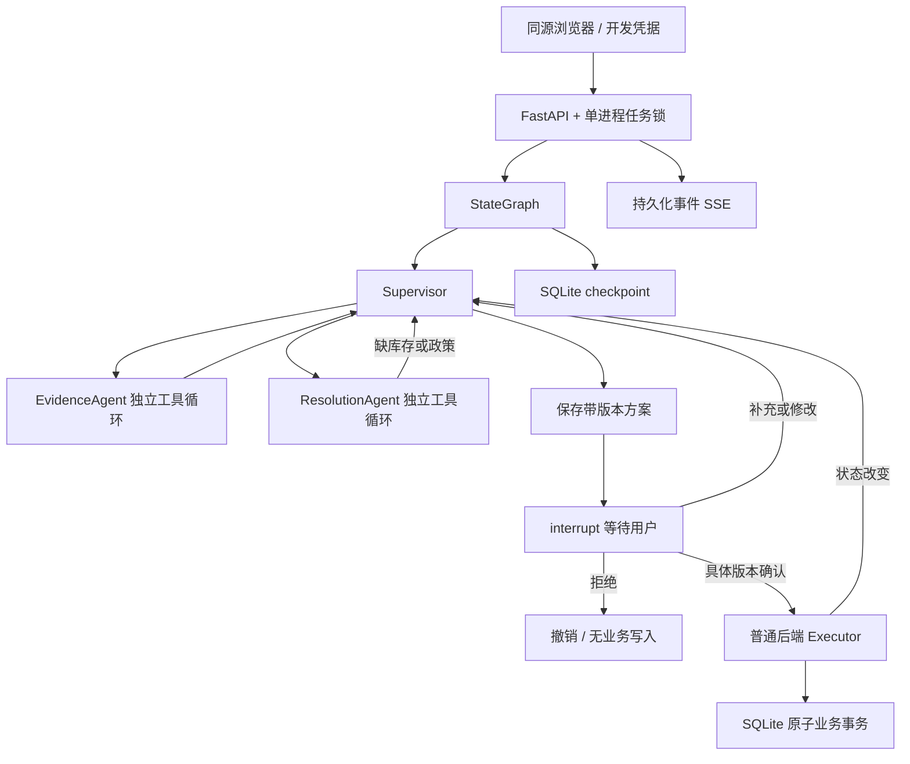

# 架构与数据流

`aftersale/graph.py:Workflow.build` 定义实际控制流。每次委派新建 `local`，专业 Agent 只能看到任务摘要、用户已声明参数、自己的工具观察；Resolution 额外收到结构化事实与政策，库存补查仅收到订单 SKU。没有共享全量聊天历史，也不记录思维链。

`loop` 的每一步调用 provider.decide → 验证 Decision → ToolRunner.call → 把实际工具返回加入 observations → 再决策。默认 demo_rules 是规则替身；model 模式才有真实 JSON 模型决策。demo 不是三段固定提示词生成。Supervisor 依据 gaps/needs 返回 ask/evidence/resolution/propose；换货分支经过初查、资格、库存补查、再资格四次委派。

方案最终候选由 `eligibility.qualify` 规范化，来自工具事实与受信任政策。模型决定观察顺序和停止，不能自行编造金额、引用或扩大动作范围。六个小文档采用中文 BM25 + 标题词面排名 RRF，保留全文 chunk、相对文件名、版本与内容指纹。这是最低独立词面 RAG，未复制原工程的完整自适应五路、向量模型或重排器。

`Service` 组装依赖、线程级任务锁和 saver。业务 DB 保存 orders/inventory/tasks/proposals/confirmations/records/events。checkpoint DB 单独保存图状态；两者不是一个跨库事务。等待节点只有 interrupt，写入在后续节点。状态 running/waiting_info/waiting_confirmation/executing/completed/failed/cancelled 和业务 requested/open 分开。

`Executor.execute` 从保存方案读取参数，检查任务归属、确认 ID/版本、状态、过期、政策指纹、订单完整快照、换货库存、允许动作及必要引用。BEGIN IMMEDIATE 内保存确认、预留库存、业务记录、订单状态和方案结果。task_id/proposal_id/order_id 唯一约束限制重复申请。本期每单最多一笔业务记录、每笔一个 SKU/一件，不支持复杂部分售后。

强制退出可能发生在业务提交后、图 checkpoint 刷盘前。`Service.recover` 优先核对已提交记录与 executed 方案结果，重建 completed checkpoint；否则继续相同 thread_id 的待执行节点。执行器再进入也会返回保存结果。此处由真实子进程退出测试证明，不能只靠内存锁。

总预算默认 90 步，专业循环 14 步，每一轮规划最多 6 次委派；用户补充/状态变化重规划重置委派数，全局步骤不重置。工具 3 秒超时、最多一次重试；真实模型 30 秒 HTTP 超时、无自动重试，默认每任务 40 次调用硬上限。调用失败计数也先落库，恢复不能重置预算。事件含 task/run/agent/tool/proposal/record 关联、摘要、错误及耗时；自由文本参数脱敏，不记录密钥或模型内部推理。

单 Agent 路径使用同一工具/政策/身份/确认/执行器，全部工具观察放在一个本地上下文，不经过专业委派。评测相同输入且每例新 DB，不预设协作收益。
